# MarcaYa

Sistema de control de asistencia (marcación de entrada y salida) para Recursos Humanos, pensado para Perú. Los empleados marcan desde la app móvil; RRHH ve la asistencia en un panel web.

| Parte | Tecnología | Carpeta |
|---|---|---|
| App móvil (empleados) | Flutter 3, Riverpod, flutter_animate | `lib/` |
| API | NestJS, TypeORM, JWT | `backend/` |
| Panel RRHH | Vue 3, Vite, Tailwind v4, shadcn-vue, Pinia | `admin/` |

## Capturas

### App móvil (Android)

| Login (claro) | Login (oscuro) | Home: marcar entrada |
|---|---|---|
| 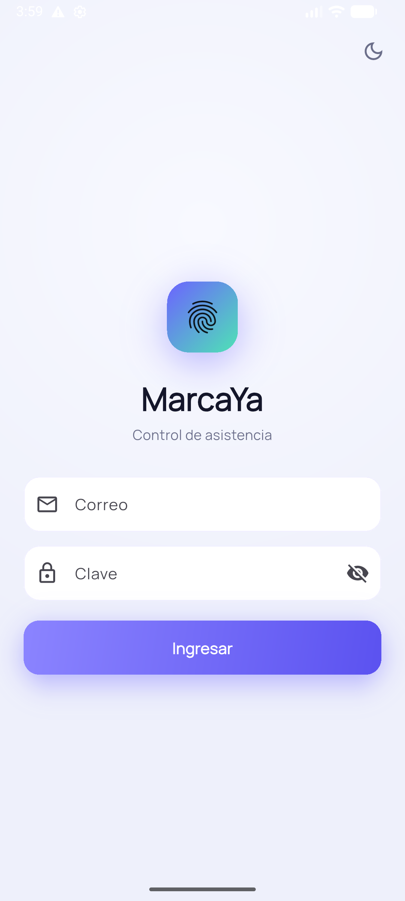 | 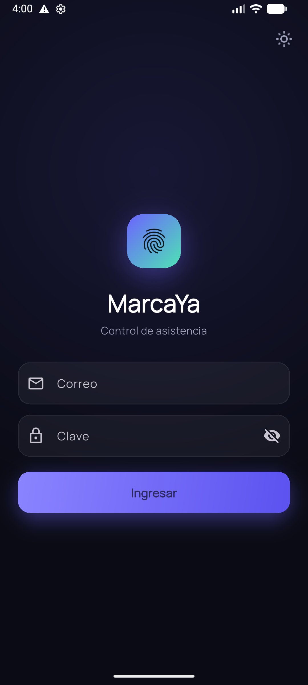 | 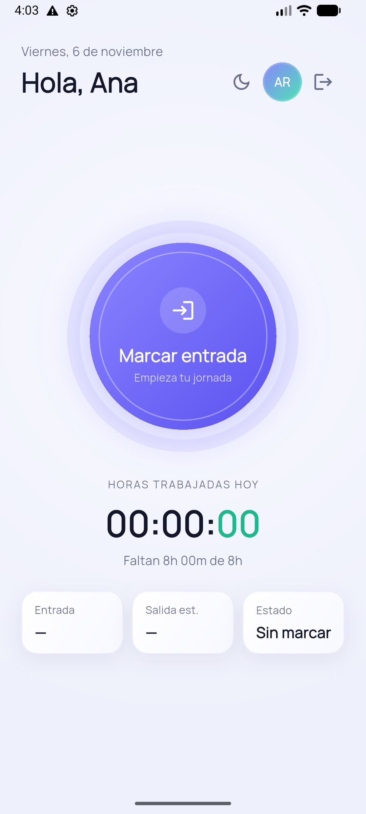 |

| Confirmación antes de marcar | Rechazo por geocerca | En turno |
|---|---|---|
| 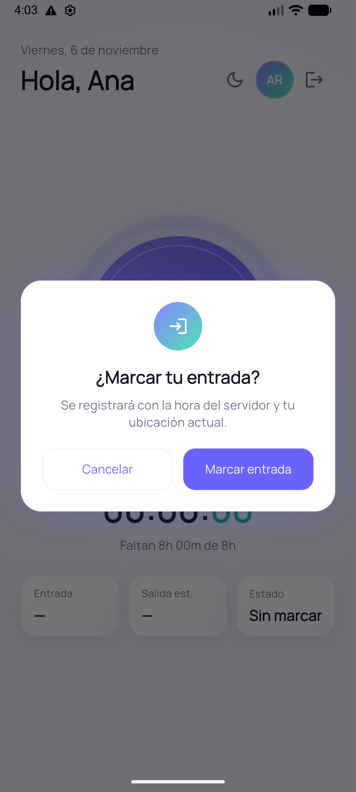 | 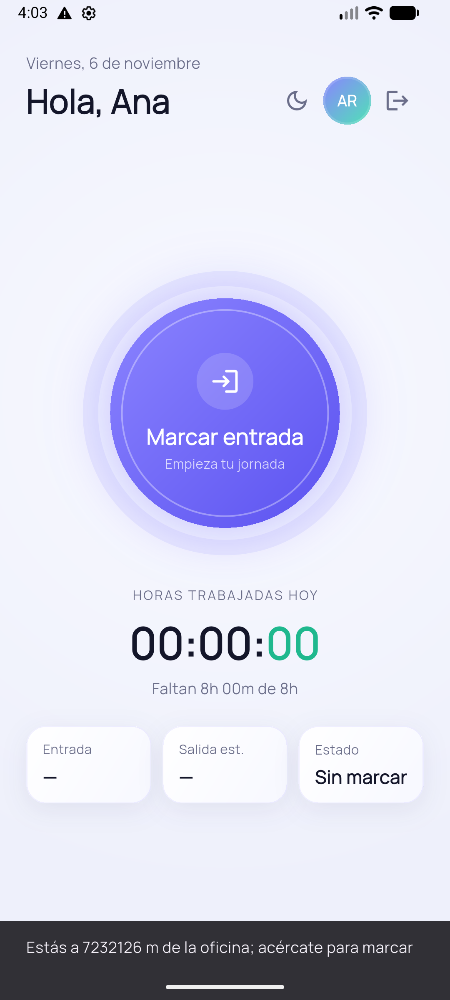 | 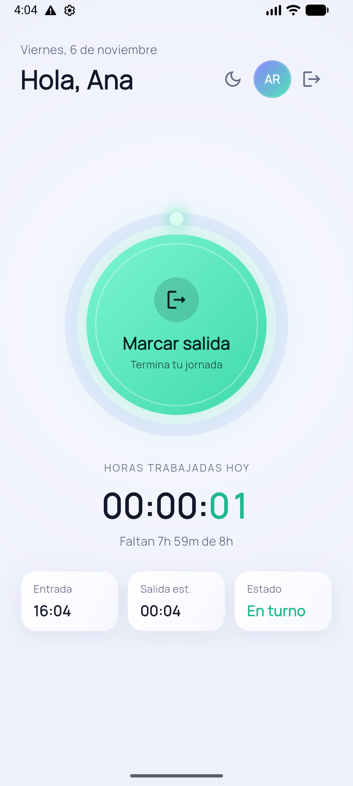 |

| En turno (oscuro) | Confirmación de salida (oscuro) |
|---|---|
| 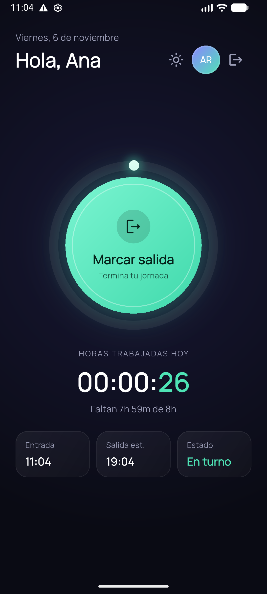 | 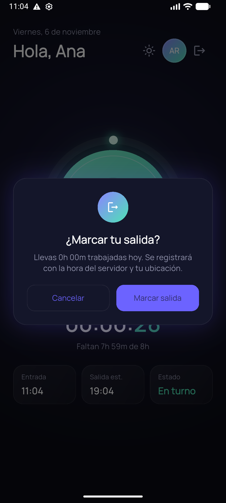 |

### Panel de RRHH

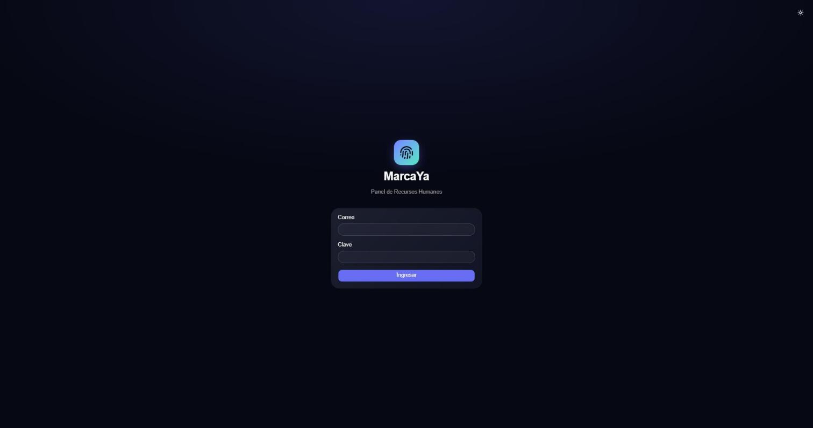

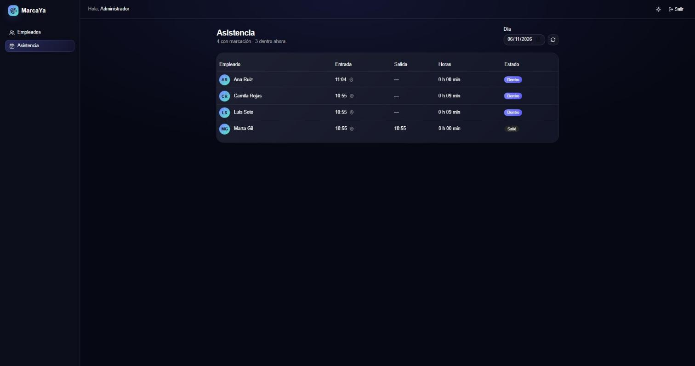

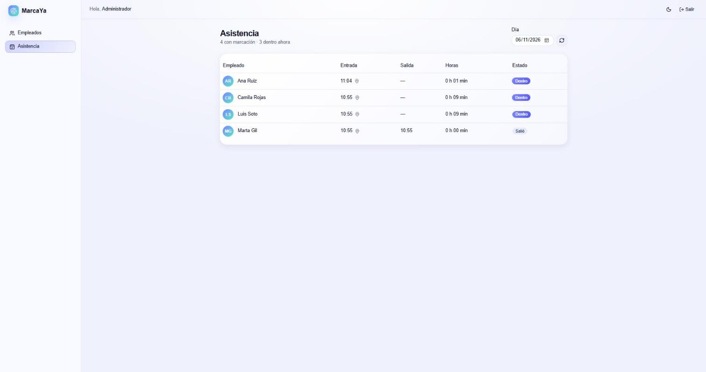

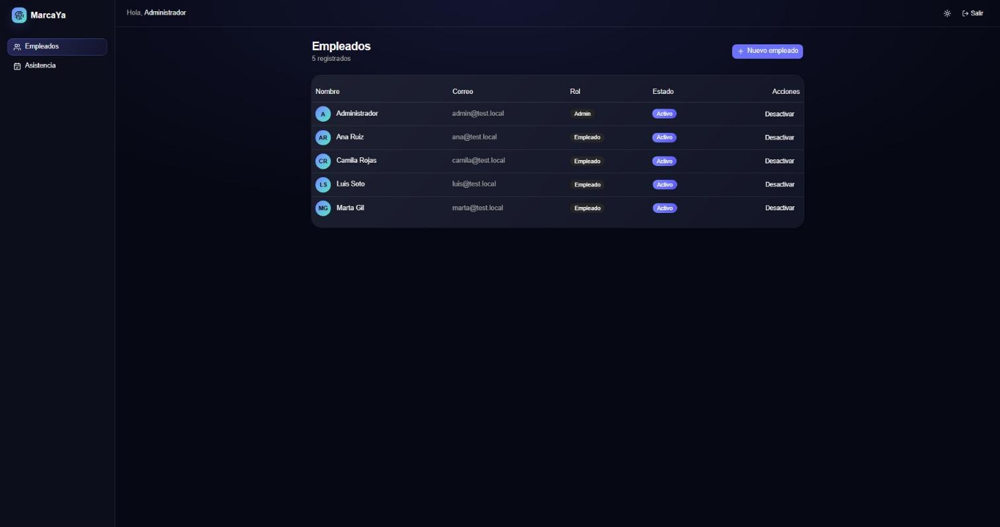

## Qué hace hoy

- **Marcación desde el móvil:** un botón alterna entre entrada y salida según el estado que dice el servidor. Antes de marcar (y antes de cerrar sesión) la app pide confirmación.
- **Hora del servidor:** la hora de cada marcación la pone siempre el backend, con los días delimitados en hora de Lima (UTC-5). El cliente no puede falsearla.
- **Secuencia válida:** no se puede marcar dos entradas seguidas ni una salida sin entrada (error 409). Marcaciones simultáneas del mismo empleado no se duplican.
- **Ubicación y geocerca:** la app envía su ubicación al marcar. Si el backend tiene configurada la oficina (`OFFICE_LAT`, `OFFICE_LNG`, `OFFICE_RADIUS_M`), rechaza las marcaciones sin ubicación o fuera del radio.
- **Panel RRHH:** gestión de empleados (crear, activar/desactivar, roles) y asistencia diaria por empleado: primera entrada, última salida, horas trabajadas, estado y enlace al mapa de la entrada.
- **Roles:** `employee`, `manager`, `hr`, `admin`. El panel solo admite `hr` y `admin`.
- **Temas:** oscuro y claro en la app y en el panel. Ver [DESIGN_SYSTEM.md](DESIGN_SYSTEM.md).

## Cómo ejecutarlo

Requisitos: Flutter 3.41+, Node.js 20+.

### 1. Backend

```bash
cd backend
npm install --legacy-peer-deps
cp .env.example .env   # ajusta JWT_SECRET y las credenciales del administrador inicial
PORT=3001 npm run start
```

Sin `DB_HOST` usa una base SQLite en memoria (sql.js): se borra al reiniciar, ideal para desarrollo. Con `DB_HOST` usa PostgreSQL. Al arrancar crea el administrador indicado en `ADMIN_EMAIL` / `ADMIN_PASSWORD`.

| Variable | Para qué sirve |
|---|---|
| `PORT` | Puerto de la API (por defecto 3000) |
| `JWT_SECRET` | Secreto con el que se firman los tokens |
| `ADMIN_EMAIL`, `ADMIN_PASSWORD` | Administrador inicial |
| `DB_HOST`, `DB_PORT`, `DB_USER`, `DB_PASSWORD`, `DB_NAME` | PostgreSQL (si falta `DB_HOST`, usa memoria) |
| `OFFICE_LAT`, `OFFICE_LNG`, `OFFICE_RADIUS_M` | Geocerca opcional (radio por defecto: 150 m) |
| `APP_TZ_OFFSET_MINUTES` | Desfase horario para los días (por defecto -300, Lima) |

### 2. Panel de RRHH

```bash
cd admin
npm install --legacy-peer-deps
VITE_API_URL=http://localhost:3001 npm run dev
```

Entra con el administrador inicial. Si el puerto 5173 está ocupado, Vite elige otro y lo muestra en consola.

### 3. App móvil

```bash
# Emulador Android: 10.0.2.2 apunta al equipo anfitrión
flutter run --dart-define=API_URL=http://10.0.2.2:3001

# Navegador (para pruebas rápidas)
flutter run -d chrome --dart-define=API_URL=http://localhost:3001

# Teléfono físico: usa la IP de tu PC en la red local
flutter run --dart-define=API_URL=http://<IP-de-tu-PC>:3001
```

Para probar la geocerca en el emulador: define `OFFICE_LAT`/`OFFICE_LNG` en el backend y mueve el GPS del emulador con `adb emu geo fix <longitud> <latitud>`.

Los empleados los crea RRHH desde el panel (o `POST /employees`): no hay registro público.

## Pruebas

```bash
flutter analyze && flutter test                # app: análisis y tests de widgets
cd backend && npm test && npm run test:e2e     # API: unitarios y extremo a extremo
cd admin && npx vitest run && npx vue-tsc -b   # panel: tests y tipos
```

## Estructura

```
lib/                     app Flutter
  core/                  tema, paleta y cliente HTTP
  features/auth/         login y sesión (token en almacenamiento seguro)
  features/attendance/   marcación, ubicación y Home
backend/src/
  auth/                  login, JWT, roles, administrador inicial
  employees/             CRUD de empleados (solo RRHH y admin)
  attendance/            marcaciones, reglas de secuencia, zona horaria y geocerca
admin/src/               panel Vue (vistas, layouts, store de sesión, tema)
docs/                    documentación y capturas
```

## Documentación

- [docs/API.md](docs/API.md): endpoints, roles y errores.
- [DESIGN_SYSTEM.md](DESIGN_SYSTEM.md): tokens de color, degradados y temas compartidos.

## Pendiente

Reconocimiento facial con prueba de vida, tablet de oficina (kiosco), integración con huella en dispositivos IoT, calendario de ausencias y vacaciones, horarios y tardanzas, modo sin conexión, tokens de refresco y registro de auditoría. Los datos biométricos son sensibles bajo la Ley 29733: antes de activarlos hace falta consentimiento expreso y revisión legal.
