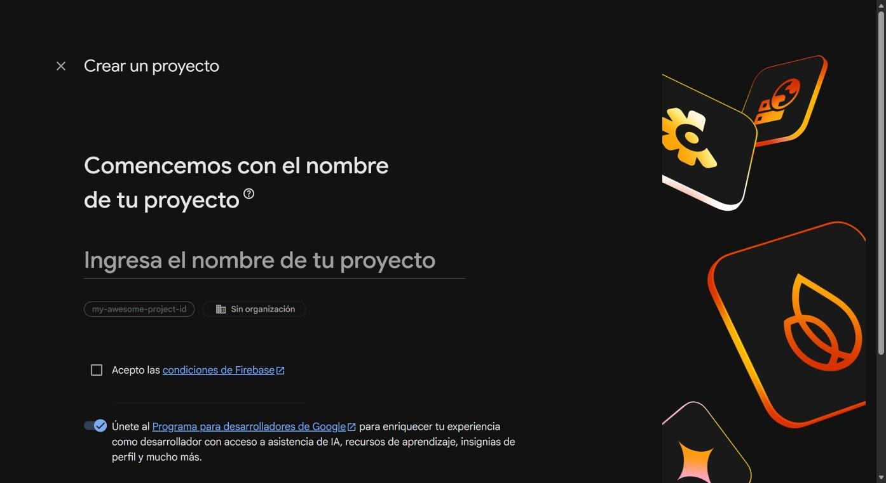
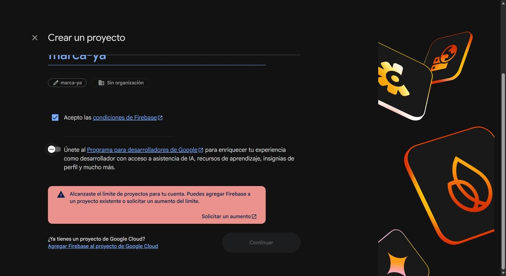
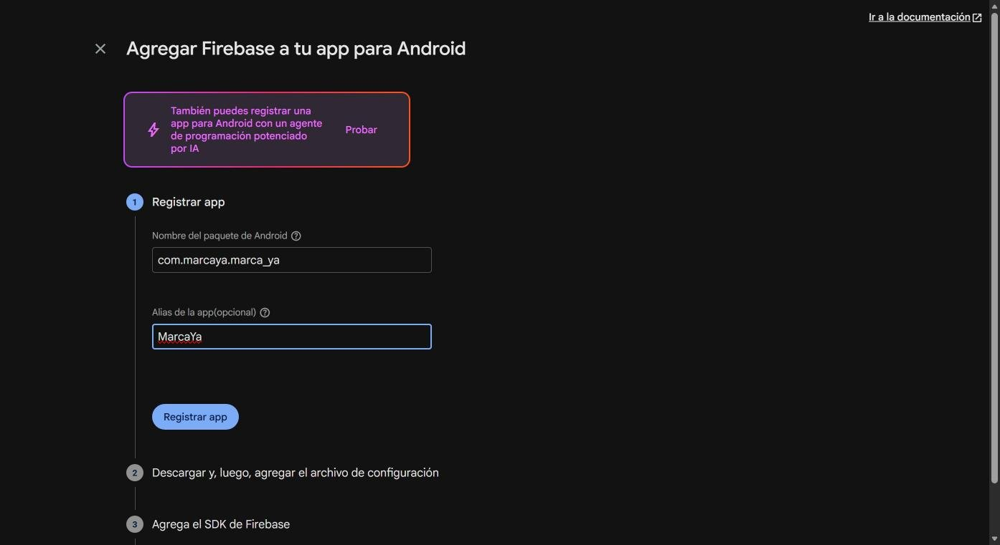
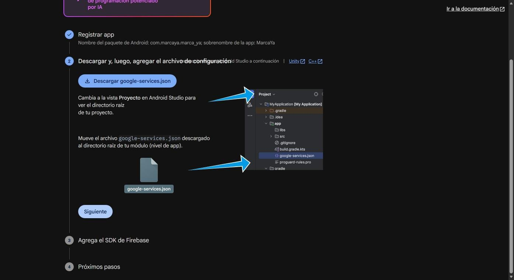
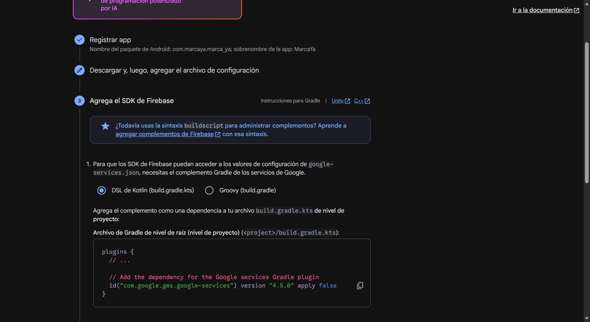
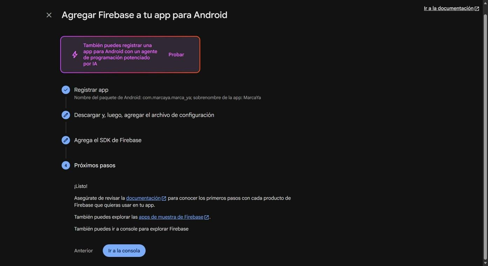
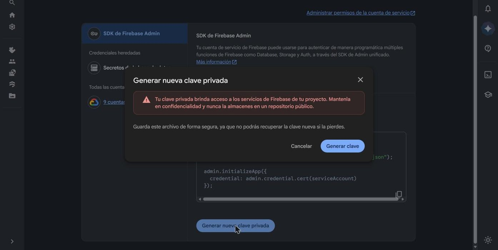
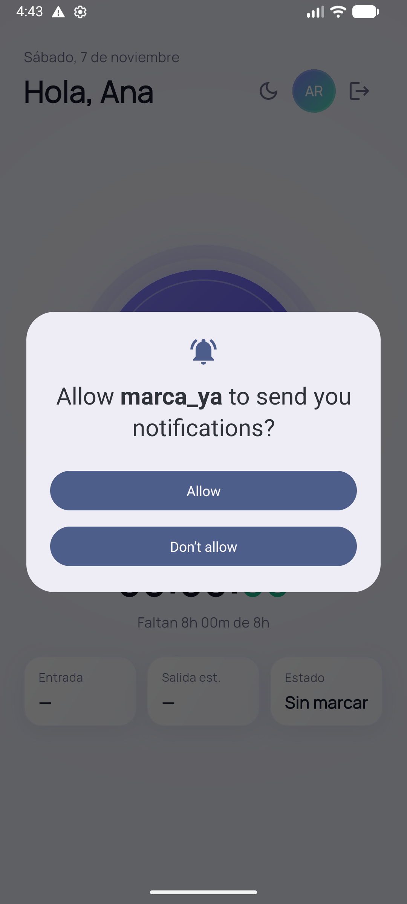

# Notificaciones push con Firebase Cloud Messaging (FCM)

Guía para configurar las notificaciones push de MarcaYa: qué hay que hacer en la consola de Firebase, qué archivos se crean, cómo conectarlos con el backend y la app, y cómo probarlo.

**Cómo funciona**

```
App Android ──(1) token FCM──▶ Backend (POST /devices) ──guarda──▶ tabla device_tokens
RRHH / tarea programada ──▶ Backend ──(2) firebase-admin──▶ FCM ──(3)──▶ teléfono
```

1. La app pide permiso, obtiene un **token** de FCM y lo registra en el backend asociado al empleado.
2. Cuando hay algo que avisar, el backend envía el mensaje a FCM con una **cuenta de servicio**.
3. FCM lo entrega al teléfono: con la app cerrada o en segundo plano lo muestra el sistema; con la app abierta, MarcaYa lo muestra como aviso en pantalla.

FCM es gratis y **no pide tarjeta ni plan Blaze**. (El aviso de Blaze que puede aparecer en la consola es de Cloud Storage, no de FCM.)

---

## 1. Consola de Firebase

Entra a <https://console.firebase.google.com/> con tu cuenta de Google.

### 1.1 Proyecto

Pulsa **Crear un proyecto**, ponle nombre (por ejemplo `marca-ya`), acepta las condiciones de Firebase y deja desactivado Google Analytics (no hace falta para FCM).



> **Límite de proyectos:** las cuentas gratuitas tienen un tope de proyectos. Si aparece "Alcanzaste el límite de proyectos", puedes reutilizar un proyecto existente (agregándole la app de MarcaYa), borrar uno que ya no uses, o pedir un aumento de cuota.
>
> 

### 1.2 Registrar la app Android

En la página del proyecto pulsa **Agregar app → Android** e ingresa:

- **Nombre del paquete de Android:** `com.marcaya.marca_ya` (es el `applicationId` de `android/app/build.gradle.kts`; debe coincidir exactamente).
- **Alias:** `MarcaYa` (opcional).



No hace falta el certificado SHA-1 para FCM.

### 1.3 Descargar `google-services.json`

Pulsa **Descargar google-services.json** y guárdalo en `android/app/google-services.json`.



Este archivo identifica tu proyecto y **no se sube a git** (ya está en `.gitignore`). Cada persona que desarrolle la app debe descargar el suyo.

### 1.4 Plugin de Gradle

El asistente muestra el plugin `com.google.gms.google-services` (versión `4.5.0` en el momento de escribir esto). Ya está aplicado en el proyecto:

- `android/settings.gradle.kts`: declara el plugin.
- `android/app/build.gradle.kts`: lo aplica **solo si existe** `google-services.json`, así la app compila igualmente sin Firebase (simplemente sin push).



No agregues el SDK de Firebase por Gradle: FlutterFire (`firebase_core`, `firebase_messaging`) ya lo incluye. Termina el asistente con **Siguiente → Ir a la consola**.



### 1.5 Llave de cuenta de servicio (para el backend)

El backend necesita una credencial para enviar mensajes. En **Configuración del proyecto → Cuentas de servicio → SDK de Firebase Admin**, pulsa **Generar nueva clave privada** y confirma.



Se descarga un JSON con una clave **secreta**. Guárdalo como `backend/.firebase-key.json` (ya ignorado por git).

> **Seguridad:** esa llave da acceso a los servicios de Firebase del proyecto. No la subas a git, no la compartas por chat ni correo y no la pegues en capturas. Si se filtra, bórrala en la misma pantalla (o en Google Cloud → IAM → Cuentas de servicio) y genera otra. En producción no uses un archivo: guarda el contenido en un gestor de secretos y pásalo en la variable `FIREBASE_SERVICE_ACCOUNT_JSON`.

La API que usa el backend es **Cloud Messaging API (HTTP v1)**, que viene habilitada por defecto en los proyectos nuevos. La "clave del servidor" antigua (API heredada) no se usa y conviene no copiarla.

---

## 2. Backend

Archivos: `backend/src/notifications/`.

| Variable | Descripción |
|---|---|
| `FIREBASE_KEY_PATH` | Ruta al JSON de la cuenta de servicio (por defecto `.firebase-key.json` en la carpeta del backend) |
| `FIREBASE_SERVICE_ACCOUNT_JSON` | Alternativa: el contenido del JSON (útil en producción) |

Si no hay credenciales, el backend arranca igual y avisa en el log "Notificaciones push desactivadas"; los envíos responden `503`.

Endpoints (ver [API.md](API.md)):

| Ruta | Quién | Para qué |
|---|---|---|
| `POST /devices` | Cualquier empleado | Registra el token FCM de su dispositivo |
| `DELETE /devices/:token` | Cualquier empleado | Lo quita al cerrar sesión |
| `POST /notifications/test` | Cualquier empleado | Envía una notificación de prueba a sus propios dispositivos |
| `POST /notifications/send` | RRHH y admin | Envía una notificación a un empleado |

Los tokens que FCM rechaza (app desinstalada, token vencido) se borran automáticamente tras el envío.

## 3. App Flutter

Archivos: `lib/features/notifications/`.

- `firebase_core` y `firebase_messaging` en `pubspec.yaml`.
- Al abrir el Home, la app inicializa Firebase, **pide el permiso de notificaciones** (Android 13 o superior) y registra el token en el backend.

  

- Al **cerrar sesión** quita el dispositivo del empleado.
- Con la app abierta, las notificaciones se muestran como aviso en pantalla; con la app en segundo plano o cerrada las muestra el sistema.
- Solo está activo en **Android**. En web y en iOS la app funciona sin notificaciones (iOS necesita además una llave APNs en Firebase, aún sin configurar).
- Se usa el token clásico de FCM (`getToken`). La versión 17 de `firebase_messaging` lo marca como obsoleto a favor de `register()`/`onRegistered`, que entregan un *Firebase Installation ID*; no lo adoptamos hasta confirmar que el envío por `firebase-admin` lo acepta.

## 4. Probar

```bash
# 1. Backend con la llave (desde backend/)
PORT=3001 JWT_SECRET=dev ADMIN_EMAIL=admin@test.local ADMIN_PASSWORD=<clave> npx nest start

# 2. App en un emulador o teléfono Android (permite las notificaciones al abrir el Home)
flutter run --dart-define=API_URL=http://10.0.2.2:3001

# 3. Envía una notificación de prueba al usuario con sesión iniciada
curl -X POST http://localhost:3001/notifications/test -H "Authorization: Bearer <token del empleado>"
```

Respuesta esperada: `{"devices":1,"sent":1,"failed":0}`. `sent: 1` significa que FCM aceptó el mensaje; `devices: 0` significa que el dispositivo no registró su token (revisa el permiso y que `google-services.json` esté en su sitio).

También puedes enviar desde la consola: **Messaging → Nueva campaña → Mensaje de prueba de notificación**, pegando el token de un dispositivo (se puede leer de la tabla `device_tokens`).

## 5. Problemas frecuentes

| Síntoma | Causa y solución |
|---|---|
| La app compila pero no hay permiso ni token | Falta `android/app/google-services.json`, o el paquete de la app registrada en Firebase no es `com.marcaya.marca_ya` |
| `503 Notificaciones no configuradas` | El backend no encontró la llave: revisa `FIREBASE_KEY_PATH` o `FIREBASE_SERVICE_ACCOUNT_JSON` |
| `sent: 1` pero el emulador no muestra nada | El emulador necesita una imagen **con Google Play** y una **cuenta de Google iniciada** (la conexión de Google Play services cae si falta; suele verse un aviso "Sign in required"). En un teléfono real normalmente funciona sin más |
| `devices: 0` | El empleado no abrió el Home con el permiso concedido, o cerró sesión (se quita el dispositivo) |
| `failed: 1` y el token desaparece | FCM lo rechazó por inválido o app desinstalada; el backend lo borra y el siguiente inicio de sesión lo registra de nuevo |
| Aviso de "Actualiza a Blaze" en la consola | Es de Cloud Storage y de proyectos con bucket por defecto; no afecta a FCM |

## 6. Siguientes pasos

- Recordatorios programados desde el backend ("olvidaste marcar tu entrada") con `@nestjs/schedule`, una vez existan horarios y turnos.
- Preferencias de notificación por empleado y horas de silencio.
- Registrar la app iOS en Firebase y subir la llave APNs.
- Abrir la pantalla correcta al tocar la notificación (`data` del mensaje).
